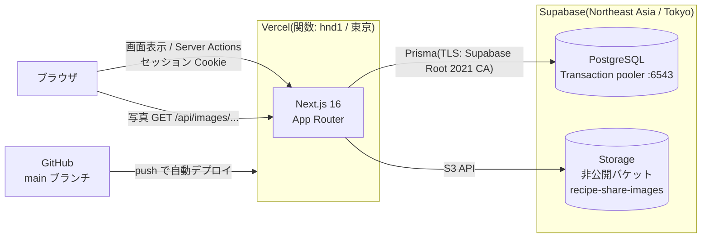
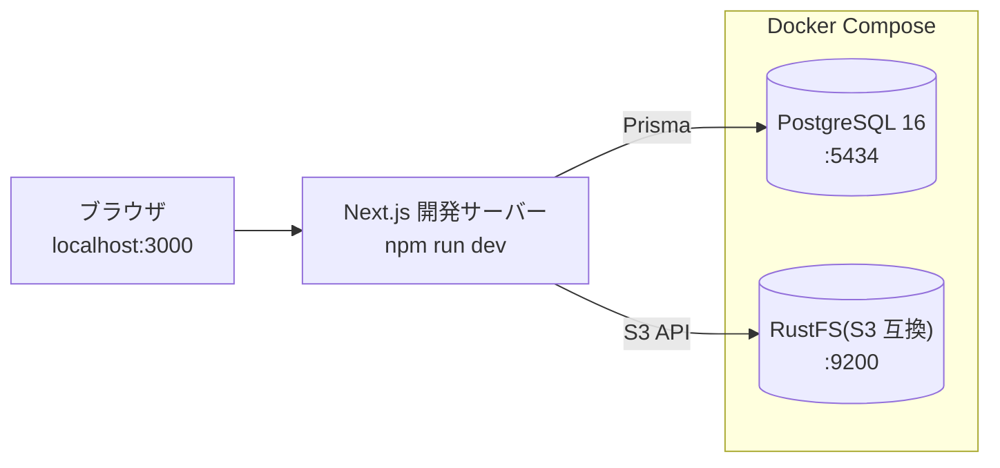
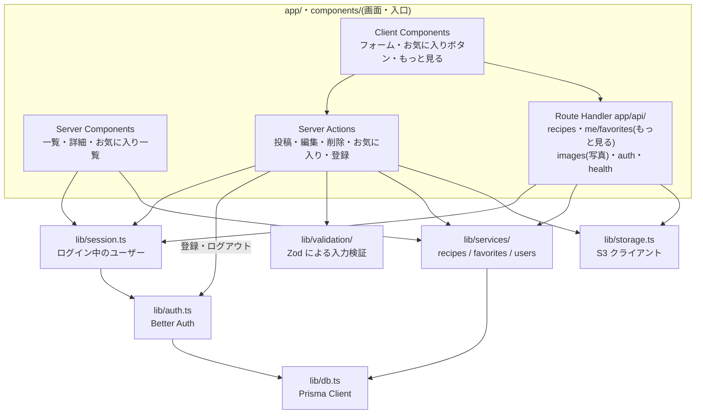
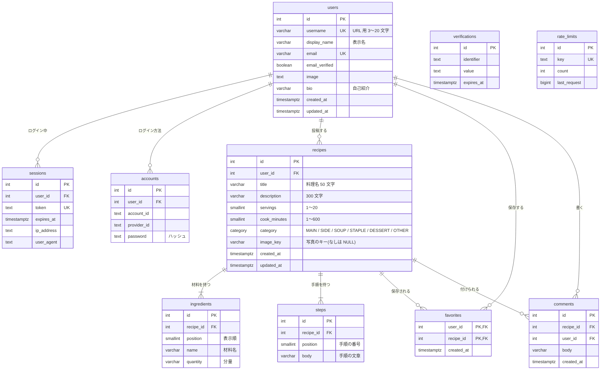

# 構成図・ER 図

システムの全体像とデータ構造を図でまとめる。詳しい方針は [技術スタック](requirements/05-tech-stack.md)、テーブルの定義は [データモデル](requirements/03-data-model.md) と `prisma/schema.prisma`(こちらが正)を参照。

## 1. システム構成(本番)

アプリは Vercel、DB と写真の保存先は Supabase。どちらも東京リージョンに置く。

- 写真のバケットは非公開のまま。ブラウザは `/api/images/<キー>` にアクセスし、アプリがストレージから読み出して返す(`next/image` で縮小、長期キャッシュ)。
- 本番 DB のマイグレーションは、デプロイの前にローカルから Session pooler(ポート 5432)に対して `prisma migrate deploy` で行う。

## 2. ローカル開発環境

テストは同じコンテナを使い、データベース・バケットを分ける(統合: `recipe_share_test`、E2E: `recipe_share_e2e_test` / `recipe-share-e2e`)。

## 3. アプリケーションの層

画面・Server Actions・Route Handler から直接 Prisma を呼ばず、必ず `lib/services/` を通す(権限確認と業務ルールをここに集める)。例外は動作確認用の `/api/health` だけ。写真の保存・読み出しは DB と関係しないため、Server Actions と画像の Route Handler が `lib/storage.ts` を直接使う。

ログは `lib/logger.ts`(JSON 1 行)で、Server Actions・Route Handler・`instrumentation.ts` から書き出す。

## 4. ER 図

認証用のテーブル(Better Auth が読み書きする)とレシピのテーブル。`comments` は v1.1(F-11)用に先に作ってあり、v1 の画面からは使っていない。

- 外部キーはすべて削除時 CASCADE(ユーザーを消すとレシピ・お気に入りも消え、レシピを消すと材料・手順・お気に入りも消える)。
- `verifications`・`rate_limits` は他のテーブルと関連を持たない。`rate_limits` は Vercel で複数のインスタンスが動くため、メモリではなく DB に置いている。
- キーワード検索(部分一致)のため、`recipes.title` と `ingredients.name` に pg_trgm の GIN インデックスを張っている。
