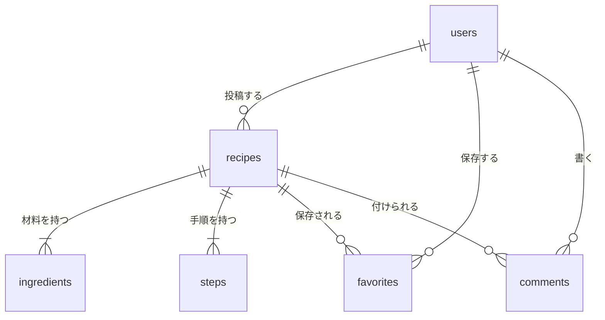

# データモデル

## 7. データモデル

### 7.1 ER図

### 7.2 テーブル定義

- 実際の定義は `prisma/schema.prisma`(と `prisma/migrations/`)が正。ここでは要点を書く。
- ID はすべて integer の連番(想定規模では十分で、JavaScript で bigint を扱う手間を避けるため)。

#### users(ユーザー)
| カラム | 型 | 制約 | 説明 |
|---|---|---|---|
| id | integer | PK | |
| username | varchar(20) | NOT NULL, UNIQUE | ユーザーページの URL に使う |
| display_name | varchar(20) | NOT NULL | 表示名(Better Auth の `name` 項目) |
| email | varchar(255) | NOT NULL, UNIQUE | ログイン ID |
| email_verified / image | boolean / text | | Better Auth が使う項目(v1 では使わない) |
| bio | varchar(200) | NULL | 自己紹介 |
| created_at / updated_at | timestamptz | NOT NULL | |

#### 認証用のテーブル(Better Auth が読み書きする)
| テーブル | 内容 |
|---|---|
| sessions | ログイン中のセッション(トークン・有効期限・ユーザー) |
| accounts | ログイン方法ごとの情報。**パスワードのハッシュはここ(`password`)に入る** |
| verifications | メール確認などの一時的なトークン(v1 では使わない) |
| rate_limits | ログイン試行などの回数の記録 |

#### recipes(レシピ)
| カラム | 型 | 制約 | 説明 |
|---|---|---|---|
| id | integer | PK | |
| user_id | integer | NOT NULL, FK → users | 投稿者 |
| title | varchar(50) | NOT NULL | 料理名 |
| description | varchar(300) | NULL | 説明 |
| servings | smallint | NOT NULL, CHECK 1〜20 | 何人分 |
| cook_minutes | smallint | NOT NULL, CHECK 1〜600 | 調理時間(分) |
| category | enum `category`(MAIN / SIDE / SOUP / STAPLE / DESSERT / OTHER) | NOT NULL | カテゴリ |
| image_key | varchar(100) | NULL | 完成写真の保存先キー(写真なしは NULL) |
| created_at / updated_at | timestamptz | NOT NULL | |

#### ingredients(材料)
| カラム | 型 | 制約 | 説明 |
|---|---|---|---|
| id | integer | PK | |
| recipe_id | integer | NOT NULL, FK → recipes(削除時 CASCADE) | |
| position | smallint | NOT NULL | 表示順(0始まり) |
| name | varchar(30) | NOT NULL | 材料名 |
| quantity | varchar(20) | NOT NULL(空文字可) | 分量 |
| | | UNIQUE (recipe_id, position) | |

#### steps(手順)
| カラム | 型 | 制約 | 説明 |
|---|---|---|---|
| id | integer | PK | |
| recipe_id | integer | NOT NULL, FK → recipes(削除時 CASCADE) | |
| position | smallint | NOT NULL | 手順の番号(0始まり、表示は +1) |
| body | varchar(300) | NOT NULL | 手順の文章 |
| | | UNIQUE (recipe_id, position) | |

> 材料・手順は、レシピの編集時に「そのレシピの行をすべて消して入れ直す」方式で更新する(並び替え・途中への追加を単純に扱うため)。

#### favorites(お気に入り)
| カラム | 型 | 制約 | 説明 |
|---|---|---|---|
| user_id | integer | PK, FK → users | |
| recipe_id | integer | PK, FK → recipes(削除時 CASCADE) | |
| created_at | timestamptz | NOT NULL | 保存日時(お気に入り一覧の並び順) |

#### comments(コメント)
| カラム | 型 | 制約 | 説明 |
|---|---|---|---|
| id | integer | PK | |
| recipe_id | integer | NOT NULL, FK → recipes(削除時 CASCADE) | |
| user_id | integer | NOT NULL, FK → users | |
| body | varchar(300) | NOT NULL | |
| created_at | timestamptz | NOT NULL | |

### 7.3 主なインデックス
- `recipes (created_at DESC)` — 新着順の一覧
- `recipes (user_id, created_at DESC)` — ユーザーページの投稿一覧
- `recipes (category, cook_minutes)` — カテゴリ・調理時間の絞り込み
- `recipes.title`、`ingredients.name` に `pg_trgm` の GIN インデックス — キーワードの部分一致検索
- `favorites (recipe_id)` — お気に入り数の集計・人気順
- `favorites (user_id, created_at DESC)` — 自分のお気に入り一覧
- `comments (recipe_id, created_at)` — レシピ詳細のコメント表示

### 7.4 画像の保存
- 画像ファイルは DB ではなくオブジェクトストレージに保存し、DB には `image_key` だけを持つ。
- ローカル開発は S3 互換ストレージ(RustFS)、本番は S3 互換のストレージを使う。アプリのコードは共通で、接続先の設定だけ切り替える。
