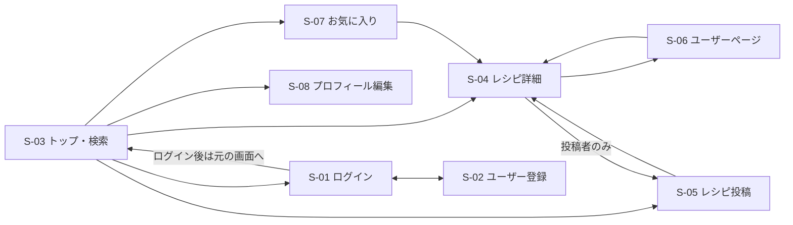

# 画面構成・画面遷移

## 8. 画面一覧
| ID | 画面 | URL | 主な機能 | ログイン |
|---|---|---|---|---|
| S-01 | ログイン | `/login` | F-02 | 不要 |
| S-02 | ユーザー登録 | `/signup` | F-01 | 不要 |
| S-03 | トップ(レシピ一覧・検索) | `/`(検索条件は `?q=&category=&maxMinutes=&sort=`) | F-05, F-07, F-10 | 不要 |
| S-04 | レシピ詳細 | `/recipes/:id` | F-04, F-06, F-08, F-11, F-14 | 不要 |
| S-05 | レシピ投稿 / 編集 | `/recipes/new` , `/recipes/:id/edit` | F-03, F-04, F-09 | 必要 |
| S-06 | ユーザーページ | `/users/:username` | F-12 | 不要 |
| S-07 | お気に入り一覧 | `/me/favorites` | F-08 | 必要 |
| S-08 | プロフィール編集 | `/me/profile` | F-13 | 必要 |

- ヘッダーには常に「ロゴ(トップへ)」「検索欄」を表示する。ログイン中は「レシピを書く」「お気に入り」「メニュー(ユーザーページ・プロフィール編集・ログアウト)」、ゲストには「ログイン」「新規登録」を表示する。

## 9. 画面遷移



## 10. 画面イメージ(ワイヤーフレーム)

### S-03 トップ(スマートフォン)
```
┌─────────────────────────┐
│ 🍳 recipe-share     ≡    │
│ [🔍 料理名・材料で検索   ] │
├─────────────────────────┤
│ カテゴリ [すべて▼]         │
│ 時間 [指定なし▼]  [新着順▼] │
├─────────────────────────┤
│ ┌──────┐ 豚の生姜焼き    │
│ │ 写真 │ 山田  ⏱15分     │
│ └──────┘ ♡ 12           │
│ ┌──────┐ ふわふわ卵焼き  │
│ │ 写真 │ 佐藤  ⏱10分     │
│ └──────┘ ♥ 8 (保存済み) │
│ ……                      │
│ [ もっと見る ]             │
└─────────────────────────┘
```

### S-04 レシピ詳細
```
┌─────────────────────────┐
│ ← 戻る          [編集][削除]│  ← 投稿者のみ
├─────────────────────────┤
│ ┌─────────────────────┐ │
│ │      完成写真        │ │
│ └─────────────────────┘ │
│ 豚の生姜焼き   [♡ 保存 12] │
│ by 山田 · 主菜 · ⏱15分     │
│ ご飯がすすむ定番の味です。  │
├─────────────────────────┤
│ 材料 [ 2 ▼ ]人分           │  ← F-14 で人数を変えられる
│ 豚ロース薄切り ……… 200g   │
│ 玉ねぎ ……………… 1/2個   │
│ しょうが ………… 1かけ     │
├─────────────────────────┤
│ 作り方                     │
│ 1. 玉ねぎを薄切りにする     │
│ 2. ……                    │
├─────────────────────────┤
│ コメント 3件               │
│ 佐藤: 作りました!         │
│ [コメントを書く     ][送信] │
└─────────────────────────┘
```

### S-05 レシピ投稿
```
┌─────────────────────────┐
│ ← 戻る     レシピを書く    │
├─────────────────────────┤
│ 料理名 [               ]  │
│ 写真   [ 画像を選ぶ ]       │
│ 説明   [               ]  │
│ [2]人分  [15]分  [主菜▼]   │
│ 材料                       │
│ ≡ [豚ロース    ][200g ] × │  ← ≡ で並び替え、× で削除
│ ≡ [玉ねぎ      ][1/2個] × │
│ [ + 材料を追加 ]            │
│ 作り方                     │
│ ≡ 1 [玉ねぎを薄切り…   ] × │
│ [ + 手順を追加 ]            │
│ [ 投稿する ]               │
└─────────────────────────┘
```
