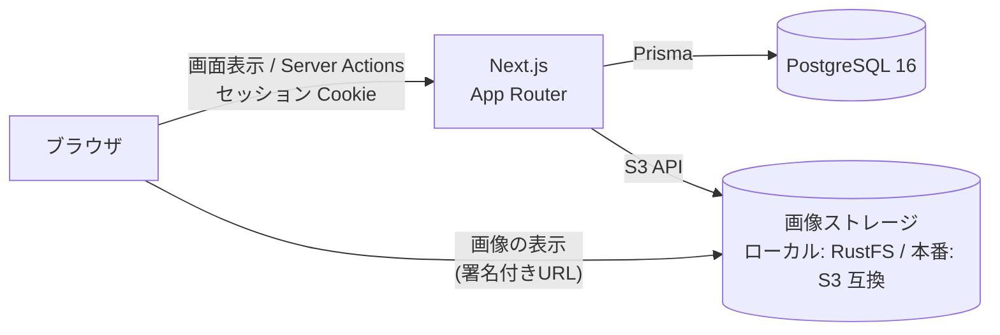

# 技術スタック

## 11. 技術スタック

これまでのアプリ(React + Spring Boot)とは別の技術を学ぶため、**Next.js(TypeScript)のフルスタック構成**にする。
画面とサーバー処理を1つの Next.js プロジェクトに TypeScript で書く。
バージョンを変える場合は、[変更管理](08-change-management.md) に記録する。

### 11.1 全体構成

- **画面**: App Router を使う。一覧・詳細などの表示は Server Components でサーバー側でデータを取得して描画する。並び替え・お気に入りボタンなど操作が必要な部分だけ Client Components にする。
- **更新処理**: 投稿・編集・削除・お気に入り・コメントは Server Actions で行う。入力は Zod でサーバー側でも検証する。
- **認証**: Better Auth(メールアドレス + パスワード)。セッションは DB に保存し、Cookie で受け渡す。認証用のエンドポイントは Route Handler(`/api/auth/[...all]`)に置く。
- **層の分け方**: `app/`(画面・Server Actions)→ `lib/services/`(業務ルール・権限確認)→ Prisma(DB アクセス)。Server Actions から直接 Prisma を呼ばず、必ず service を通す。
- **ディレクトリ構成**: リポジトリ直下に Next.js プロジェクトを置く(`app/`、`components/`、`lib/`、`prisma/`、`tests/`)。`docs/` はドキュメント、`docker-compose.yml` はローカルの DB・画像ストレージ。

### 11.2 アプリケーション
| パッケージ / ツール | バージョン | 用途 |
|---|---|---|
| Node.js | 24.x | 実行環境 |
| TypeScript | 6.0.3 | 言語(`strict: true`) |
| Next.js | 16.4.5 | フレームワーク(App Router、Server Actions) |
| React / React DOM | 19.3.1 | UI ライブラリ |
| Prisma(`prisma` / `@prisma/client` / `@prisma/adapter-pg`) | 7.10.1 | ORM・マイグレーション(Prisma Migrate) |
| Better Auth | 1.7.18 | 認証(メールアドレス + パスワード、DB セッション、ログイン試行の制限) |
| Zod | 4.6.7 | 入力検証(画面とサーバーで同じスキーマを使う) |
| server-only | 0.0.1 | DB・認証の処理をブラウザ用のコードに混ぜないための目印 |
| @aws-sdk/client-s3 / @aws-sdk/s3-request-presigner | 3.1164.0 | 画像ストレージ(S3 互換)への保存・署名付き URL(F-09 で導入) |
| @dnd-kit/core / @dnd-kit/sortable | 6.3.1 / 10.0.0 | 材料・手順の並び替え(F-03 で導入) |
| スタイル | CSS Modules(Next.js 標準) | 追加のライブラリは使わない |

### 11.3 開発・品質
| パッケージ / ツール | バージョン | 用途 |
|---|---|---|
| ESLint / eslint-config-next | 10.14.0 / 16.4.5 | Lint(Next.js 推奨ルール) |
| @types/node / @types/react / @types/react-dom | 24.19.2 / 19.3.0 / 19.3.0 | 型定義 |
| dotenv | 18.0.9 | Prisma CLI に `.env` を読ませる(`prisma.config.ts`) |
| Vitest | 5.1.0 | 単体テスト(service 層・入力検証) |
| @testing-library/react | 16.3.3 | 画面部品のテスト(必要になったときに導入) |
| @playwright/test | 1.65.0 | E2E テスト(投稿 → 検索 → お気に入りの一連の流れ。6日目に導入) |

- バージョンは 2026-11-08 時点の安定版。環境構築(Issue #7)で組み合わせて動くことを確認し、`.npmrc` の `save-exact=true` と `package-lock.json` で固定した(`^` を付けない)。
- 型チェックは `next typegen && tsc --noEmit`(Next.js がルートの型 `PageProps` / `LayoutProps` などを生成してから確認する)。
- Next.js 16.4 の雛形は Cache Components(`cacheComponents: true`)が有効。DB を読む処理はリクエスト時に動かす(Route Handler では `connection()` を先に呼ぶなど)。

### 11.4 データベース・ストレージ・開発環境
- PostgreSQL 16(`docker-compose.yml` でローカル起動。イメージ `postgres:16`)。他アプリの DB と同時に起動できるよう、ホスト側ポートは 5434 を使う。拡張機能 `pg_trgm` は Prisma のマイグレーション SQL で有効にする。
- 画像ストレージ: ローカルは S3 互換の RustFS(`rustfs/rustfs:1.0.1`)。本番は S3 互換のストレージ([要確認ポイント](09-open-questions.md) Q-06)。アプリのコードは共通で、接続先の設定だけ切り替える。
- 画像アップロードは Server Actions で受け取るため、`next.config` の `serverActions.bodySizeLimit` を写真の上限(5MB)より少し大きい値にする。
- CI: GitHub Actions(型チェック `tsc --noEmit`、ESLint、Vitest、ビルド)。E2E テストは手元で実行する。
