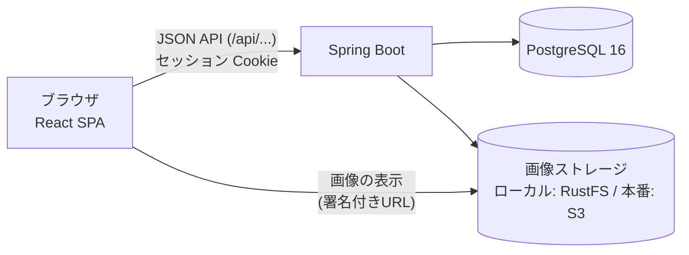

# 技術スタック

## 11. 技術スタック

これまでのアプリ(trello-clone / sns-timeline-app)と同じ構成・バージョンにそろえる。
バージョンを変える場合は、[変更管理](08-change-management.md) に記録する。

### 11.1 全体構成

- フロントエンドとバックエンドは別プロセスで起動し、開発時は Vite のプロキシで `/api` をバックエンドへ転送する。
- ディレクトリ構成: `app/`(フロントエンド)、`backend/`(バックエンド)、`docs/`(ドキュメント)、`docker-compose.yml`(ローカルの DB・画像ストレージ)

### 11.2 フロントエンド
| パッケージ / ツール | バージョン | 用途 |
|---|---|---|
| Node.js | 24.x | 実行環境 |
| React / React DOM | 19.2.8 | UI ライブラリ(JavaScript。TypeScript は使わない) |
| React Router | 7.18.4 | 画面遷移・検索条件の URL 管理 |
| Vite | 8.2.1 | 開発サーバー・ビルド |
| @vitejs/plugin-react | 6.0.5 | Vite の React 対応 |
| @dnd-kit/core / @dnd-kit/sortable | 6.3.1 / 10.0.0 | 材料・手順の並び替え |
| oxlint | 1.77.0 | Lint |
| Vitest | 5.0.5 | 単体テスト |
| @testing-library/react | 16.3.3 | 画面単位のテスト |

### 11.3 バックエンド
| パッケージ / ツール | バージョン | 用途 |
|---|---|---|
| Java (JDK) | 21 | 実行環境 |
| Maven | 3.9.9 | ビルド |
| Spring Boot(`spring-boot-starter-parent`) | 3.3.4 | web / security / validation / actuator / test |
| Spring Security | Spring Boot 3.3.4 の管理バージョン | セッション認証・CSRF 対策 |
| データアクセス | Spring Data JPA(Spring Boot 3.3.4 の管理バージョン) | DB アクセス。※ MyBatis にするかは [要確認ポイント](09-open-questions.md) Q-05 |
| PostgreSQL JDBC Driver | 42.7.4 | DB 接続 |
| Flyway | 10.10.0 | マイグレーション |
| AWS SDK for Java v2(BOM) | 2.28.29 | 画像ストレージ(S3 互換)へのアクセス |
| Checkstyle / SpotBugs | 14.4.0 / 4.10.5.0 | 静的解析 |

### 11.4 データベース・ストレージ・開発環境
- PostgreSQL 16(`docker-compose.yml` でローカル起動。イメージ `postgres:16`)。他アプリの DB と同時に起動できるよう、ホスト側ポートは 5434 を使う。拡張機能 `pg_trgm` を使う。
- 画像ストレージ: ローカルは S3 互換の RustFS(`rustfs/rustfs:1.0.1`)。ポートは他アプリと重ならないものを設計時に決める。
- CI: GitHub Actions(バックエンドのテスト・静的解析、フロントエンドの Lint・テスト・ビルド)
